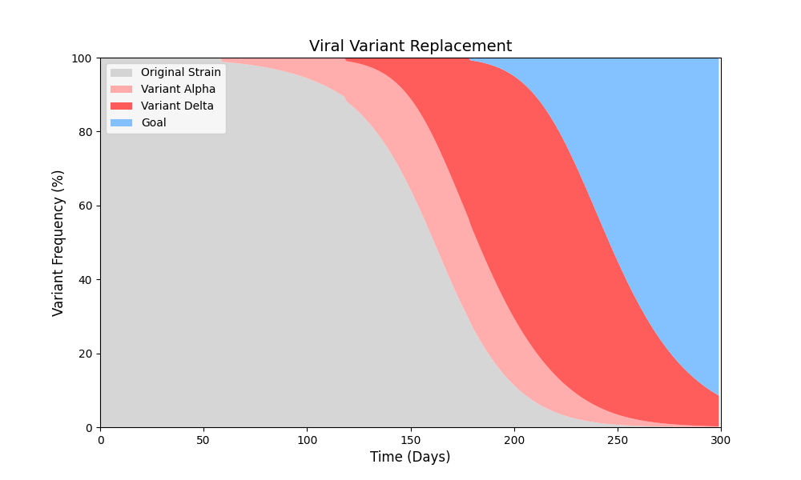

# Week 1: Exploring evolutionary simulation

## Research motivation

I wanted to explore whether computational models could help explain how viral variants replace one another. My initial idea was to predict evolutionary change and investigate, conceptually, whether competition could favor less harmful variants. Repeated replacement of existing variants made this an interesting modeling problem.

The first step was a deliberately simple competition model. Four hypothetical strains share a carrying capacity, differ in growth rate, and enter at different times. This illustrates competitive replacement; it is not a predictive model of a real virus.

## Model and results

[Simulation source](viral_variant_competition.py)

The simulation runs for 300 days with growth rates 0.20, 0.28, 0.40, and 0.65, a common removal rate of 0.10, and carrying capacity 1,000. Strains appear on days 0, 60, 120, and 180. The first strain starts with 10 individuals; subsequent strains enter with five.

$$
n_i(t+1)=\max\left(0,n_i(t)+r_i n_i(t)\left(1-\frac{\sum_j n_j(t)}{K}\right)-m n_i(t)\right).
$$

The chart illustrates replacement as faster-growing strains enter. The final strain's label, "Goal," reflects my original motivation; the model contains no mechanism for virulence, immunity, or clinical outcomes. Its growth-rate assumptions drive the result.

## Further work and learning

A useful next step would be to compare a more realistic model with empirical data and examine unintended outcomes of any proposed intervention. This simulation cannot establish the feasibility or safety of controlling real viral evolution.

I began without prior high-school coursework in biology or evolution. I asked generative AI for help choosing a mathematical model and used a Lotka–Volterra-style competition model as a starting point. I wanted to learn how programming skills developed as a hobby could support scientific investigation.