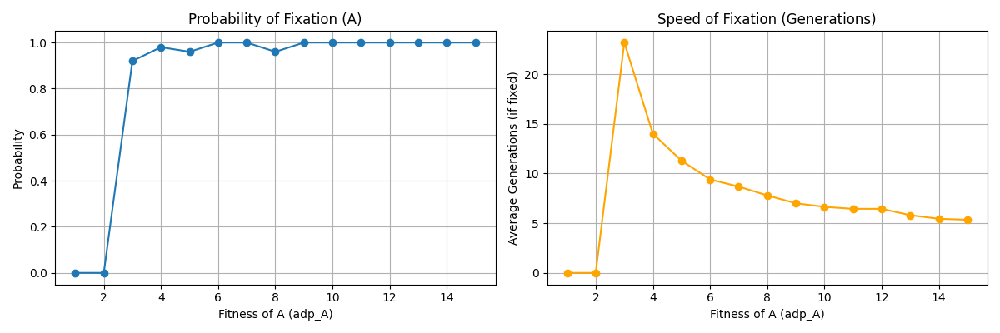
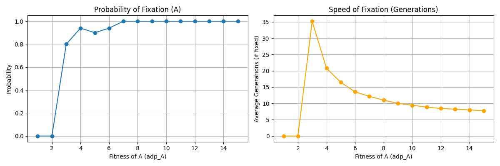
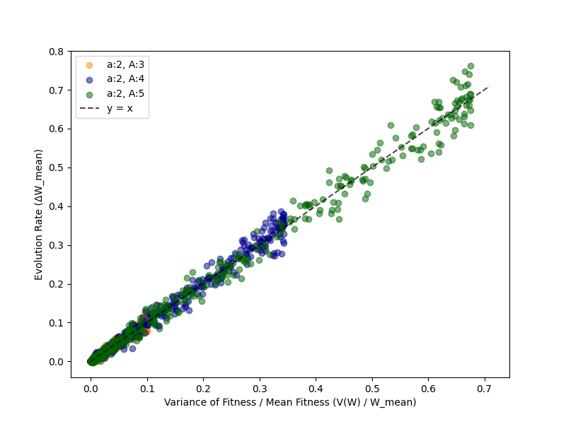

# Week 3: Adaptive evolution

## 1. Fitness, fixation probability, and time to fixation

[Fixation experiment](main.py)

I used a discrete stochastic haploid model based on the course exercise. Initially there is one A individual and $N-1$ a individuals. Reproduction follows integer fitness, and random sampling limits the next generation to the population size.

I held the fitness of a at 2 and varied A's fitness from 1 to 15. Each setting used 50 trials of at most 100 generations. I compared populations of 100 and 1,000.

Increasing A's fitness generally increased observed fixation probability and reduced the time among successful trials. Near-100% fixation in 50 trials is an empirical frequency, not a guarantee.

The original report described the time decline as approximately exponential and suggested limited population-size dependence. These plots alone do not establish either claim; fitted models, more repetitions, and broader population sizes would be needed.

The code records zero time when no trials fix. Such points mean "no observed fixation," not instantaneous fixation. The 100-generation observation window also limits interpretation.

## 2. Fisher's fundamental theorem of natural selection

[Main experiment](main3.py) · [Earlier implementation](main2.py)

I investigated the relationship between fitness variation and changing mean fitness using 1,000 individuals, 100 generations, and 30 trials per condition. Fitness of a remained 2; fitness of A was 3, 4, or 5. Each trial began with a single A individual.

For each generation I plotted

$$
x=\frac{V(W)}{\bar W},\qquad y=\Delta\bar W.
$$

The points cluster around $y=x$, consistent with the simplified relationship

$$
\Delta\bar W=\frac{V(W)}{\bar W}
$$

under this model's assumptions. Greater variation provides more scope for selection; finite-population sampling produces scatter.

Fitness remains constant and depends on just two alleles. Changing environments or ecological interactions could alter fitness, making them useful extensions.

## Implementation and AI assistance

I used AI to draft the broad structure, then revised the algorithm, organization, and variable names and used NumPy for speed. Coding conventions were informed by course examples. Handouts and starter files are excluded from the public collection.

## Open question

What organisms and experimental conditions would allow the predictions of such a simple model to be tested?