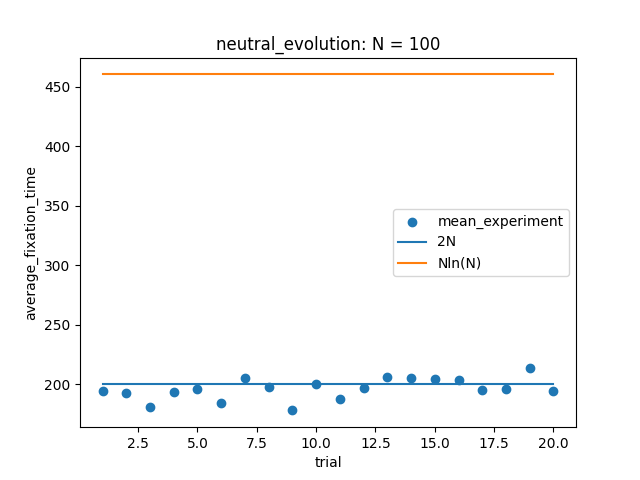
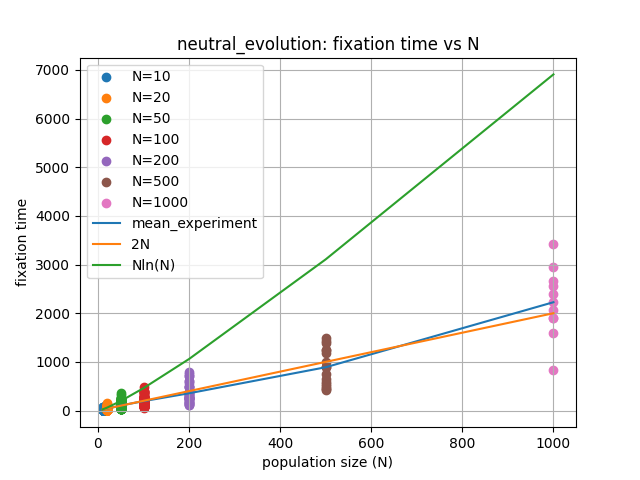

# Week 4: Neutral evolution and population bottlenecks

## 1. Conditional time to fixation

[Simulation engine](neutral.py) · [Repeated experiment](main.py)

I simulated neutral drift in a haploid Wright–Fisher model, starting with one mutant in a population of $N$. I measured the average time **conditional on fixation**, rather than averaging over both fixation and loss.

For $N=100$, the recorded means lie near $2N=200$, below $N\ln N\approx461$.

## 2. Scaling with population size

[Population-size sweep](main2.py)

I tested $N=10,20,50,100,200,500,1000$, with 10,000 trials and a limit of 10,000 generations per trial.

The means were close to $2N$, while the spread increased with population size. Some individual times approached or exceeded the $N\ln N$ comparison curve, but that curve did not describe the mean well.

The diffusion approximation cited in the original report gives

$$
T(p)=-2N\frac{1-p}{p}\ln(1-p).
$$

With $p=1/N$ and $\ln(1-1/N)\approx-1/N$,

$$
T(1/N)\approx2(N-1)\approx2N.
$$

The finite generation limit censors long trajectories. Few initially rare mutants fix at large $N$, so more trials would improve estimation.

## 3. Extension: a temporary bottleneck

[Bottleneck experiment](main3.py)

I compared a constant population of 500 with one falling from 500 to 10 during generations 80–99, then returning to 500. Both start at mutant frequency 0.1, with 20 trajectories over 200 generations.

The original report described abrupt changes during the bottleneck: three of 20 trajectories fixed, many were lost, and some reached frequencies of 0.6–0.8. These are observations from the original run.

**Figure availability:** the original report's third image was missing from the project folder. It is not embedded here; the script can generate a new realization.

With fewer individuals, each sampled individual accounts for a larger share of the population, amplifying random changes. The original discussion used cheetah genetic diversity as a motivating example, rather than as validation of this model.

## References and assistance

- Motoo Kimura and Tomoko Ohta (1968). *The Average Number of Generations until Fixation of a Mutant Gene in a Finite Population*.
- Cheetah Conservation Fund Japan. *Genetic Diversity*. [Background reading](http://ccfjapan.org/1_about_cheetah3_gene.html), accessed May 19, 2026.

I used AI assistance for the bottleneck function and revised it. The neutral model was adapted from a course exercise.