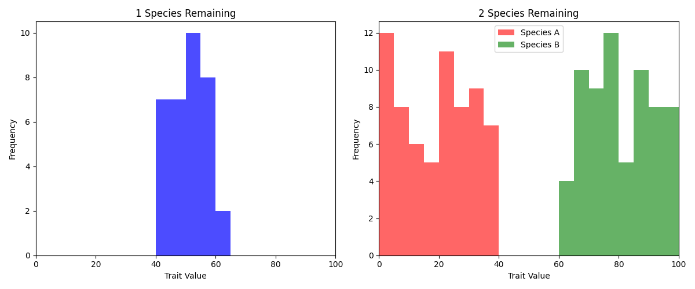
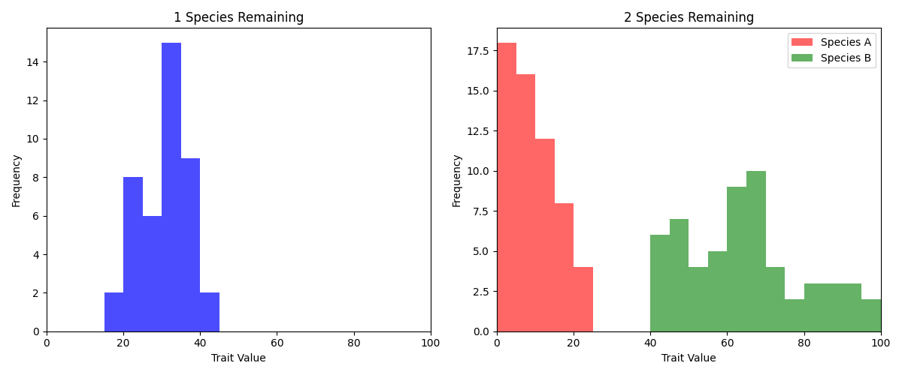
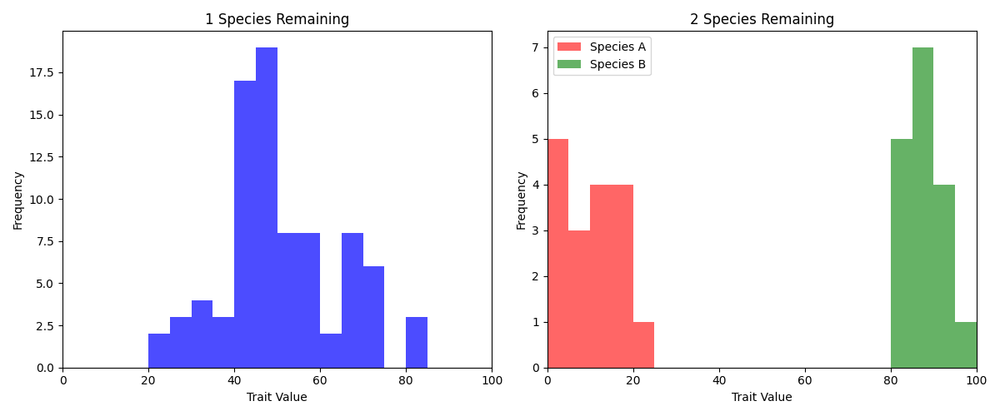

# Week 6: Diversity and ecological niches

## 1. One surviving type or two coexisting types?

[Main experiment and clustering](resource_competition_analysis.py)

I extended a two-resource competition exercise from 10 to 100 trials. Traits from 0 to 100 represent a resource-acquisition tradeoff: lower values favor resource a, higher values favor b. I compared surviving traits when one or two types remained.

I calculated competition coefficients from resource-use overlap, inspired by MacArthur's resource competition theory, and grouped survivors into three k-means clusters.

The original report described 50 units of each resource with linear acquisition probabilities. The saved implementation uses `Psize=101` and `current_beta=Psize-current_alpha`, so `alpha_num=50` actually allocates 50 and 51 slots. This discrepancy is documented for reproducibility.

| Recorded quantity | Value |
| --- | ---: |
| Total trials | 100 |
| Trials with two surviving types | 66 |
| Two-type trials with either competition coefficient above 1 | 0 |
| Cluster center: a specialists | 11.6 |
| Cluster center: generalists | 42.7 |
| Cluster center: b specialists | 80.2 |

Single-type outcomes concentrated around traits 40–60. Two-type outcomes tended to include specialists near 1–20 and 80–100. A specialist leaves resources available for a type favoring the other resource, reducing competition.

For the Lotka–Volterra comparison, stable coexistence requires

$$
\frac{K_2}{\alpha_{21}}>K_1,\qquad \frac{K_1}{\alpha_{12}}>K_2.
$$

Equal carrying capacities reduce these conditions to $\alpha_{12}<1$ and $\alpha_{21}<1$. None of the 66 two-type trials had a calculated coefficient above 1. This is a consistency check under a simplified mapping, not proof that the stochastic and continuous models are identical.

## 2. Unequal resource availability

Settings: `analyze(trials=100, alpha_num=70, periodic_mode=False)`.

The intended comparison was a 70:30 split; the saved implementation uses 70:31.

Cluster centers were 10.6, 37.9, and 70.9. Survivors shifted toward stronger acquisition of a, including generalists below trait 50.

I did not interpret this scenario using the equal-capacity coexistence criterion. Unequal resources require reconsidering carrying capacities and the model mapping.

## 3. Periodically changing resources

Settings: `analyze(trials=100, alpha_num=50, periodic_mode=True)`.

Resource a alternates between 70 and 30 slots every 100 generations; b receives the remaining slots. The intended conceptual comparison was 70:30 versus 30:70.

Intermediate types commonly survived alone. Specialists can prosper during one phase and decline sharply in the next, while generalists can use both resources. I omitted k-means interpretation for this scenario.

The original discussion connected this mechanism to changing resources and selection in Galápagos finches. This motivates the experiment but does not establish that the model reproduces their ecology.

## Other implementations

- [Alternative periodic and nonlinear model](periodic_resource_competition.py), with 80:21 and 20:81 phases.
- [Nonlinear competition-coefficient exploration](nonlinear_resource_competition.py).
- [Continuous Lotka–Volterra comparison](periodic_lotka_volterra.py).

## References and provenance

- University of Tokyo Life Science Textbook Editorial Committee (2025). *Life Science through Physics, Chemistry, and Mathematics* [English translation of title]. Yodosha.
- JT Biohistory Research Hall. *Galápagos Finches*, issue 117. [Background reading](https://www.brh.co.jp/publication/journal/117/papercraft), accessed June 9, 2026.

The resource model originated in a course example. My extensions included repeated experiments, resource perturbations, competition-coefficient checks, and clustering. The starter file is kept with private course materials.