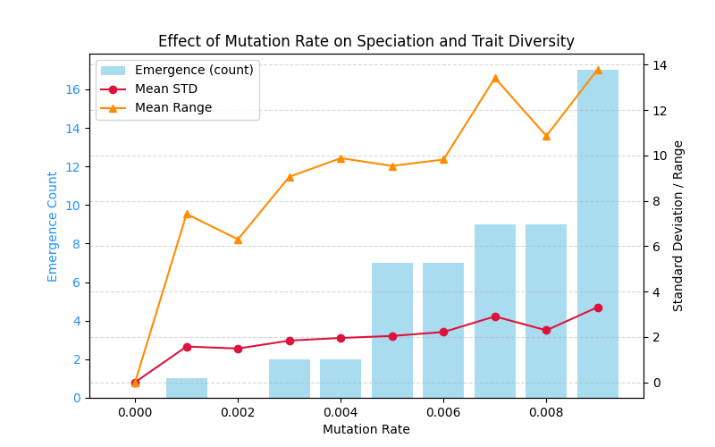
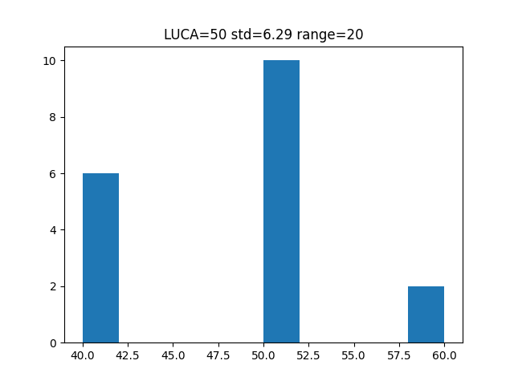
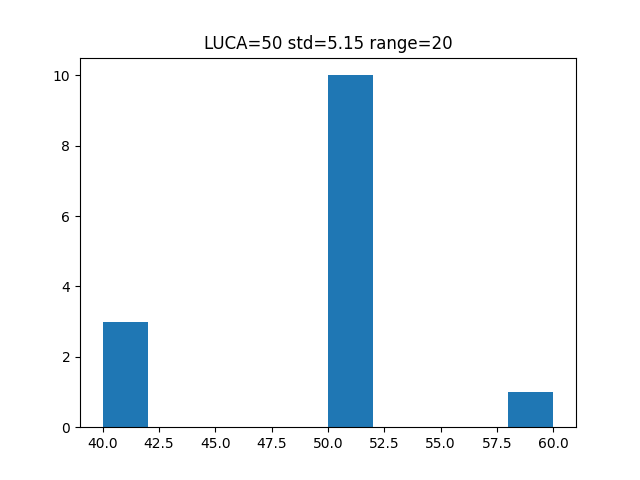
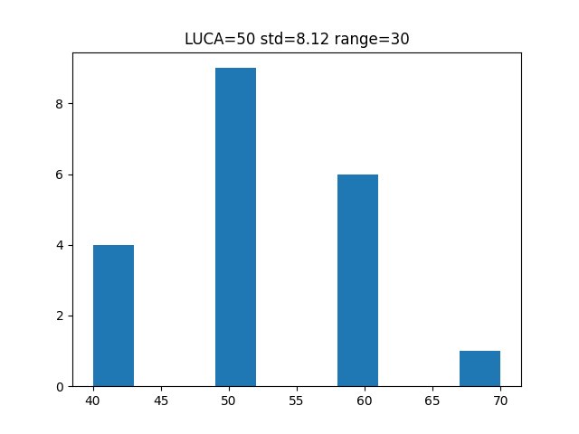
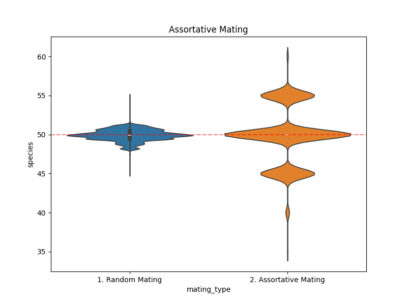

# Week 7: Mutation, divergence, and assortative mating

## Question

Under what conditions can an initially uniform population develop distinct trait groups?

I adapted a two-resource course model into [a reusable mutation simulation](mutation_divergence_model.py), then varied mutation frequency, step size, and mating behavior. These traits represent resource preferences; calling a trait group a "species" is an operational simplification.

## 1. Mutation probability

[Mutation-rate sweep](mutation_rate_sweep.py)

I increased mutation probability from 0% to 0.9% in increments of 0.1%, with 50 trials per value. The initial trait was 50. The intended emergence criterion was a survivor at least five units away from that trait.

I pooled distinct survivors across trials, measuring spread and range alongside emergence counts.

Higher probabilities generally produced wider distributions and more divergence events. The emergence count at 0.008 was lower than at 0.007 in the recorded run, illustrating stochastic variation.

**Implementation caveat:** the saved source includes the ancestral trait in the `new_species` filter (`p == LUCA`), so its counter does not implement the intended criterion. Its spread statistics are cumulative pooled values, rather than independent per-trial values. The historical figure is preserved, but quantitative emergence claims require regeneration with a corrected metric. The publication cleanup does not silently replace these results.

## 2. Mutation step size

I compared steps of 5 and 10, with 50 trials and histogram output.

Larger steps produced more separated groups. A step of 10 can produce traits 40 or 60 directly from 50, with rare outcomes reaching 70. Recorded sets included {40, 50}, {40, 50, 60}, {40, 60}, and {50, 60, 70}.

Greater separation in resource preference may permit coexistence. These are stochastic realizations, not evidence of a universal threshold.

## 3. Extension: assortative mating

[Assortative-mating experiment](assortative_mating.py)

I compared random mating with mating restricted to similar traits. Offspring inherit the average of their parents' traits, with mutation step 5. Parents at 40 and 60 therefore produce an offspring near 50; random mating can blend emerging groups.

The experiment uses mating thresholds of 100 and 3, respectively, with 100 trials of 1,000 generations.

The recorded random-mating population concentrated near the initial trait, while assortative mating produced separated concentrations. This supports the proposed mechanism within the model; it does not establish reproductive isolation in a real species.

The implementation bounds resource-acquisition attempts and falls back to the first parent's trait when it cannot find a suitable mate. These choices matter for interpretation.

## Further work

Correct the emergence metric, quantify uncertainty across independent trials, and test the persistence of clusters. An additional [mutation-step experiment](mutation_step_sweep.py) is retained.