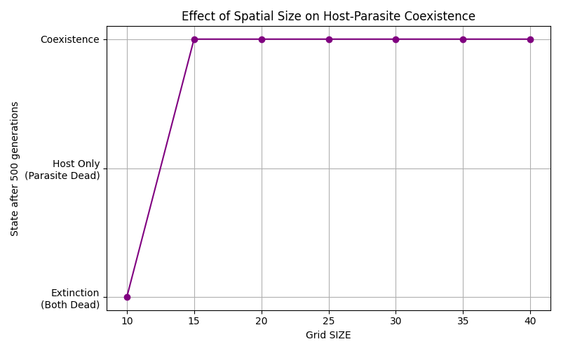
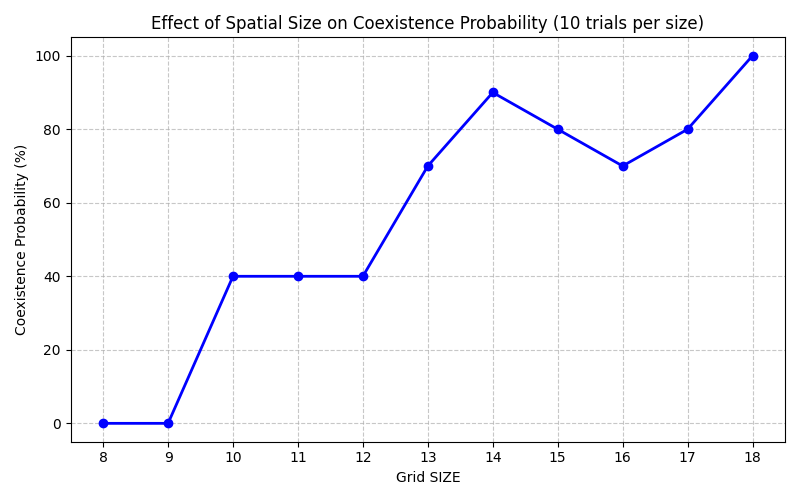
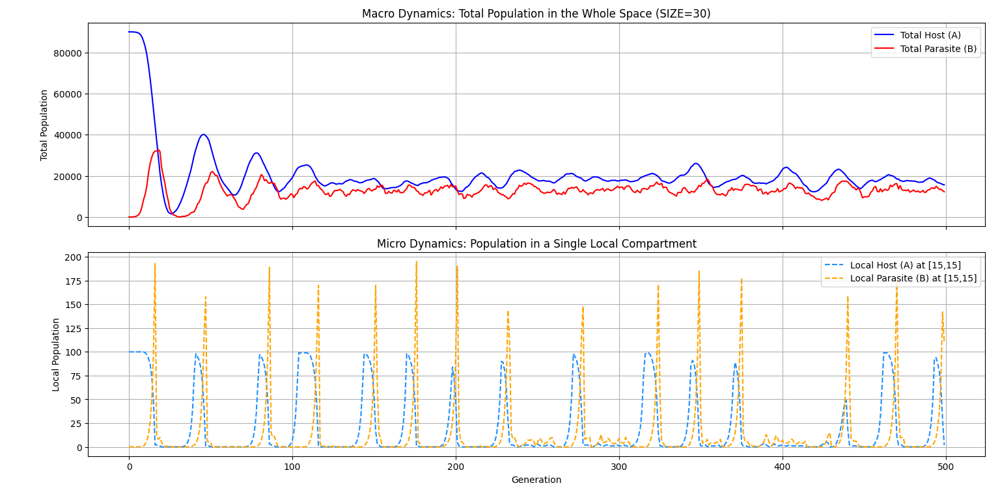
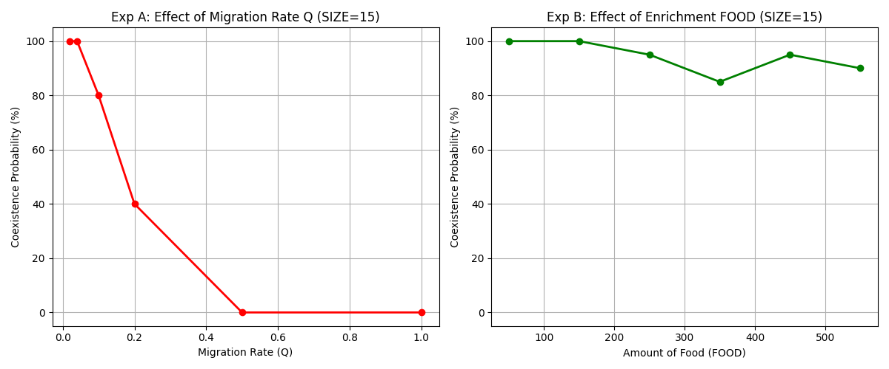

# Week 9: Spatial structure and host–parasite coexistence

## Implementation and AI assistance

I refactored the spatial course model into [a simulation function](spatial_host_parasite_model.py), then used it for sweeps and population-history analysis. I used generative AI for much of this week's code, reviewed it line by line, and revised it as needed.

The square-grid model combines local host reproduction, food limits, parasite appearance, and movement.

## 1. How much space permits coexistence?

[Coarse sweep](grid_size_survival_sweep.py) · [Repeated sweep](grid_size_coexistence_trials.py) · [Population histories](metapopulation_dynamics.py)

I first tested grid widths 10–40 in increments of 5, recording survival after 500 generations.

The transition appeared near widths 10–15. I examined nearby widths with 10 trials each.

Coexistence generally became more likely in larger grids, with fluctuations expected from the small trial count.

Hosts can survive in one patch while parasites deplete another. Small grids provide fewer spatial refuges. I interpreted this in terms of metapopulation dynamics.

## 2. Local fluctuations and global persistence

For a 30-by-30 grid, I compared total populations with those in the central patch at [15, 15].

Local host counts sometimes approached zero while both populations persisted globally. Parasite increases followed host increases, producing delayed cycles reminiscent of predator–prey dynamics. Spatially displaced cycles can allow global persistence despite local collapse.

## 3. Migration and food availability

[Parameter sweep](migration_food_coexistence_sweep.py)

I used width 15 with 20 trials per setting. Width 30 had shown no extinction in my exploratory runs.

Migration parameter Q took values 0.02, 0.04, 0.10, 0.20, 0.50, and 1.00. Food took values 50, 150, 250, 350, 450, and 550. Other parameters used baseline values, including parasite-appearance parameter P=0.010.

Higher migration reduced coexistence. Faster movement weakens spatial separation, allowing parasites to reach patches where hosts would otherwise escape temporarily.

The original report compared this conceptually with human mobility and epidemic spread. The model does not represent a human disease, immunity, or realistic mortality.

Increasing food produced a smaller, noisier decrease in coexistence. Larger host populations may support larger parasite populations and more extreme oscillations. This explanation needs more replicates and direct fluctuation measurements.

## Limitations and reference

Coexistence means survival at a finite observation time. Integer-threshold movement and appearance parameters are not automatically exact per-individual probabilities. Grid size, update order, and observation duration affect the results.

The original report consulted the encyclopedia entry on metapopulations on June 25, 2026. [English background reading](https://en.wikipedia.org/wiki/Metapopulation).

[Alternative exploratory implementation](spatial_host_parasite_numba.py).