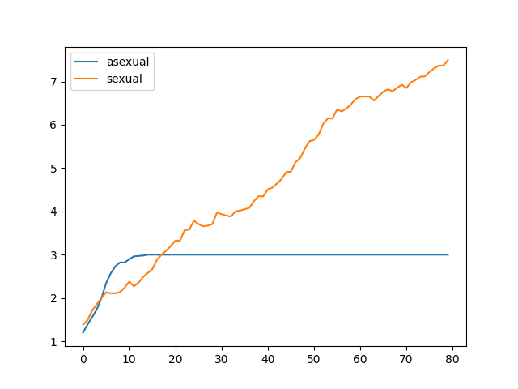
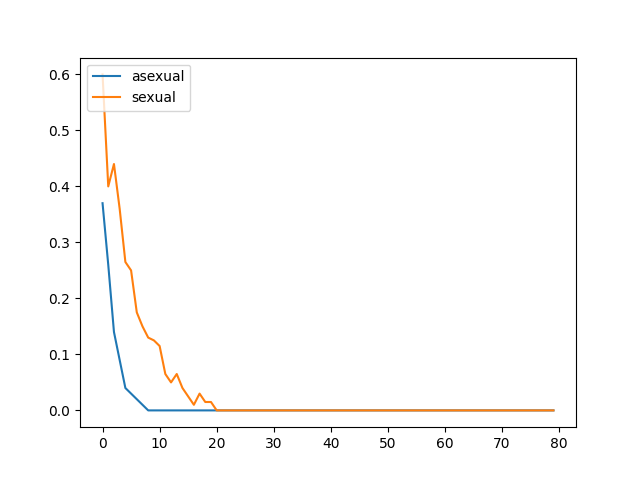
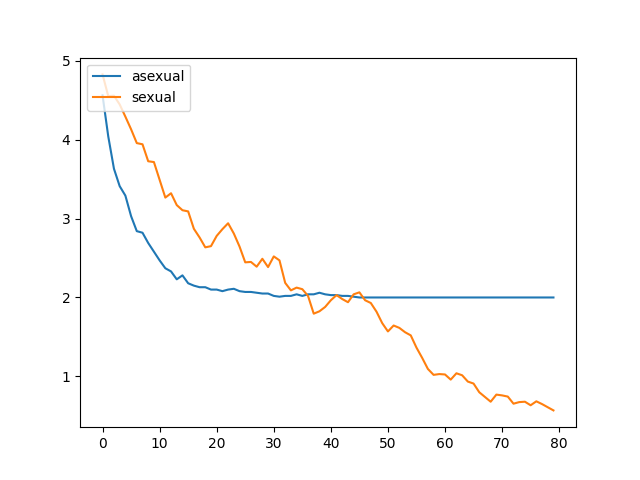
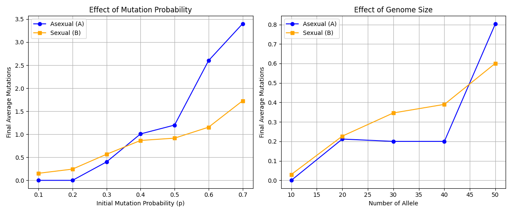
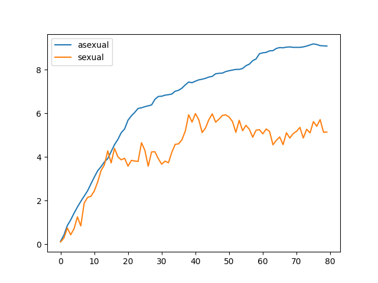
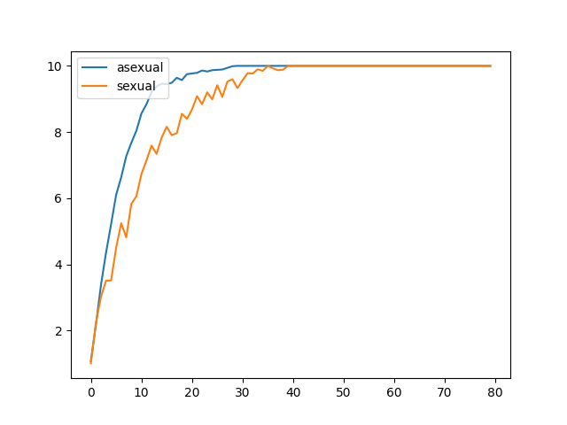

# Week 10: Sexual reproduction and host–virus coevolution

## 1. Beneficial mutations introduced at initialization

I first ran the course baseline comparing asexual and sexual populations. The horizontal axis shows generations; the vertical axis shows mean mutations per chromosome.

The asexual population initially improved quickly but plateaued near three mutations. The sexual population started more slowly, then reached approximately 7.5 by generation 80.

Without further mutation, asexual lineages can only copy existing genotypes; the best initial clone sets a ceiling. Recombination can combine beneficial alleles across individuals, though it also produces less favorable offspring.

The baseline teaching code is excluded from the public files. This figure records my experiment with it.

## 2. Removing deleterious mutations

With mutation effect -1, population size 100, initial mutation probability 0.1, 10 loci, and baseline fitness 2, sex was not advantageous.

I explored greater initial mutation probabilities and more loci, raising baseline fitness to 10 to reduce immediate extinction.

[Parameter-sweep source](initial_mutation_load_sweep.py)

Here $p$ is the probability of a mutated locus **at initialization**, not during reproduction. Asexual populations removed mutations more effectively at $p\leq0.3$; sexual populations had fewer mutations from about $p=0.4$ upward. The locus-count effect was nonmonotonic, and five replicates are insufficient for a general conclusion.

### Why initial variation matters

The expected initial number of mutation-free asexual individuals is

$$
\lambda_0=N(1-p)^L.
$$

For $N=100$ and $L=10$, this is approximately 34.9 at $p=0.1$, but 0.098 at $p=0.5$. Asexual reproduction can amplify mutation-free clones if they already exist. Otherwise it cannot create offspring with fewer mutations than its best clone. Recombination can assemble unmutated alleles from different parents.

This resembles a reason recombination can counter mutation accumulation, but it is not a full Muller's-ratchet model: mutation occurs only at initialization.

## 3. Mutation during reproduction

I also ran the continuous-mutation course baseline. The first run used population 100, nominal mutation parameter 0.01, mutation effect 2, 10 loci, and baseline fitness 1.

The next run used population 100, nominal parameter 0.1, mutation effect 2, 10 loci, and baseline fitness 2.

Continuous mutation lets asexual lineages exceed the best initial genotype. In these recorded runs, asexual populations accumulated mutations faster. Recombination can assemble favorable combinations or break them apart.

Both populations reached 10 in the second run. Each locus changes only from 0 to 1, giving a hard ceiling. The baseline's inclusive `random.randint(0, int(1/p))` rule gives actual probability

$$
1/(\operatorname{int}(1/p)+1).
$$

At $p=0.1$, a completely unmutated chromosome therefore has about $10/11$ expected new mutations per replication. Already-mutated loci cannot change further. Strong mutation pressure and the finite-locus ceiling contribute to saturation.

The teaching implementation is kept privately. Archived parameter settings need not match later exploratory scripts.

## 4. Extension: host–virus coevolution

[Simulation](host_virus_coevolution.py) · [Detailed discussion](host_virus_coevolution_discussion.md)

I wanted to test whether evolving parasites could favor sex despite mate-search costs. I developed the model with generative AI assistance and used an AI editor to help implement and vectorize it. The infection criterion is an assumption, not an empirical formula.

There are 200 hosts, initially half sexual and half asexual, and 80 viruses. Each has eight binary loci. Asexual hosts copy their genotype; sexual hosts inherit each locus from either of two sexual parents with equal probability.

Sexual reproduction is weighted by the probability of finding a sexual mate in 10 encounters. Infection requires at least seven matching loci. Host fitness declines with the fraction of infective viruses, using cost parameter 0.95. Mutation probabilities per locus are 0.001 for hosts and 0.02 for evolving viruses.

The original experiment compared no viruses, static viruses, and evolving viruses for 250 generations with 20 trials per condition.

The original discussion reported final sexual frequencies of 0.194, 0.233, and 0.550, respectively.

Under static viruses, resistant asexual clones can spread without mating costs. Evolving viruses track successful host genotypes, potentially favoring new combinations produced by sex. Infection remained variable and diversity was higher under evolving viruses. Diversity is the number of distinct host genotypes divided by the smaller of population size and the number of possible genotypes.

These are historical reported results. The original seed was not recorded, and the saved trial driver contained a call-signature error repaired for publication. New runs will differ from the archived image.

## Limitations and next steps

The model assumes free recombination, binary genotype matching, and equal host and viral generation lengths. It contains no explicit immunity or real infection mechanism. Results illustrate a possible Red Queen mechanism, not direct biological validation.

Follow-up work could vary infection thresholds, generation-time ratios, and mating costs, with uncertainty estimates across recorded seeds.

## Other experiments

- [NumPy deleterious-mutation exploration](deleterious_mutations_numpy.py).
- [Simulation versus recurrence approximation](recombination_theory_comparison.py).
- [Alternative repeated simulation and theoretical comparison](recombination_replicate_comparison.py).

Course-derived baselines are separated from this public collection. See the provenance notes for course-model and AI-assistance disclosures.