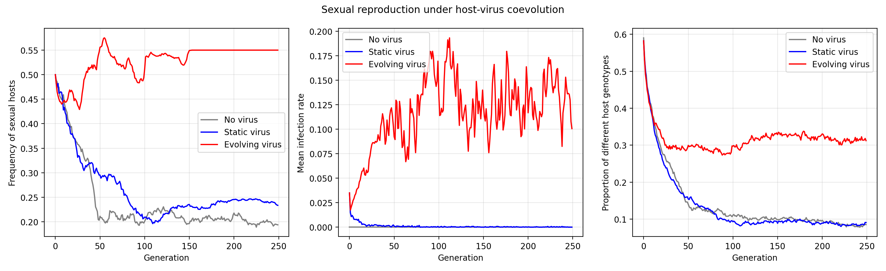

# Evolution in Code

Python experiments exploring natural selection, genetic drift, ecological diversity, and host–virus coevolution. Developed for Advanced Science at the University of Tokyo; course grade: **98/100**.

I extended weekly exercises with repeated trials, parameter sweeps, theoretical comparisons, and additional experiments on bottlenecks, assortative mating, and evolving viral pressure. The reports explain the assumptions, historical results, limitations, and use of AI assistance.



*The original coevolution experiment compared sexual-host frequency, infection, and genotype diversity under three viral conditions. This is an illustrative model, not a prediction about a real virus.*

## Explore the reports

| Week | Topic | Report |
| --- | --- | --- |
| 1 | Competition between hypothetical viral variants | [Variant competition](01_guidance/viral_variant_competition_report.md) |
| 3 | Selection, fixation, and fitness variation | [Adaptive evolution](03_adaptation/adaptive_evolution_report.md) |
| 4 | Neutral drift and population bottlenecks | [Neutral evolution](04_neutral_evolution/neutral_evolution_report.md) |
| 6 | Resource competition and ecological niches | [Ecological niches](06_diversity/ecological_niches_report.md) |
| 7 | Mutation and assortative mating | [Mutation and mating](07_mutation/mutation_and_assortative_mating_report.md) |
| 9 | Spatial host–parasite coexistence | [Spatial coexistence](09_parasite/spatial_coexistence_report.md) |
| 10 | Recombination and host–virus coevolution | [Sexual reproduction](10_sexual/sexual_reproduction_report.md) |
| 11 | Cultural change and cooperation | [Reflective essay](11_human/human_evolution_and_cooperation_essay.md) |

Folder numbers follow the original course weeks. Gaps do not represent missing dependencies.

## Run an experiment

The project uses Python 3.11+ and uv. From the repository root:

```bash
uv sync --locked
uv run --locked python 10_sexual/host_virus_coevolution.py --seed 42 --trials 2 --generations 30 --no-show
```

The coevolution demo writes a plot and parameter record to `generated/`. Omit `--no-show` to open a plot window. Its full default experiment uses 20 trials per condition and 250 generations:

```bash
uv run --locked python 10_sexual/host_virus_coevolution.py --seed 42 --no-show
```

The archived report figure was generated before seeds were recorded. New seeded runs are separate realizations and will differ from it.

Other scripts can be run by their path, for example:

```bash
uv run --locked python 04_neutral_evolution/population_bottleneck_drift.py
```

Most original experiments open Matplotlib windows and some run large parameter sweeps. Output paths are relative to the current working directory unless specified otherwise.

## Code guide

| Folder | Implementations and experiments |
| --- | --- |
| `01_guidance` | [Viral variant competition](01_guidance/viral_variant_competition.py) |
| `03_adaptation` | [Fitness–fixation sweep](03_adaptation/fitness_fixation_sweep.py), [allele-frequency trajectories](03_adaptation/allele_frequency_trajectories.py), [fitness variance and selection](03_adaptation/fitness_variance_selection.py) |
| `04_neutral_evolution` | [Neutral drift model](04_neutral_evolution/neutral_drift_model.py), [fixation-time replicates](04_neutral_evolution/fixation_time_replicates.py), [population-size sweep](04_neutral_evolution/fixation_time_population_sweep.py), [bottleneck experiment](04_neutral_evolution/population_bottleneck_drift.py) |
| `06_diversity` | [Resource competition analysis](06_diversity/resource_competition_analysis.py), [periodic resources](06_diversity/periodic_resource_competition.py), [nonlinear competition](06_diversity/nonlinear_resource_competition.py), [periodic Lotka–Volterra comparison](06_diversity/periodic_lotka_volterra.py) |
| `07_mutation` | [Mutation model](07_mutation/mutation_divergence_model.py), [mutation-rate sweep](07_mutation/mutation_rate_sweep.py), [mutation-step sweep](07_mutation/mutation_step_sweep.py), [assortative mating](07_mutation/assortative_mating.py) |
| `09_parasite` | [Spatial model](09_parasite/spatial_host_parasite_model.py), [grid-size survival sweep](09_parasite/grid_size_survival_sweep.py), [coexistence trials](09_parasite/grid_size_coexistence_trials.py), [metapopulation dynamics](09_parasite/metapopulation_dynamics.py), [migration and food sweep](09_parasite/migration_food_coexistence_sweep.py), [Numba implementation](09_parasite/spatial_host_parasite_numba.py) |
| `10_sexual` | [Deleterious mutations](10_sexual/deleterious_mutations_numpy.py), [theoretical comparison](10_sexual/recombination_theory_comparison.py), [initial mutation-load sweep](10_sexual/initial_mutation_load_sweep.py), [replicate comparison](10_sexual/recombination_replicate_comparison.py), [host–virus coevolution](10_sexual/host_virus_coevolution.py) |

The [coevolution discussion](10_sexual/host_virus_coevolution_discussion.md) gives a focused explanation of the final extension.

## Naming and reproducibility

Filenames use descriptive English `snake_case`. Models end in `_model.py`; parameter studies use `_sweep.py` or `_trials.py`; reports identify their subject. Figure names describe the experiment or comparison, with parameters included where needed to distinguish saved results.

The original scripts are exploratory coursework. Some saved defaults differ from the settings reported in the historical figures, and the reports document known discrepancies. Renaming the files does not alter the simulation algorithms or the archived images.

Lecture handouts and recognizable starter files are kept locally in the ignored `course_materials/` folder. Images awaiting review are in the ignored `unneed/` folder. The reports distinguish course models, student extensions, and AI assistance; course-derived source remains subject to the course's publication policy.
